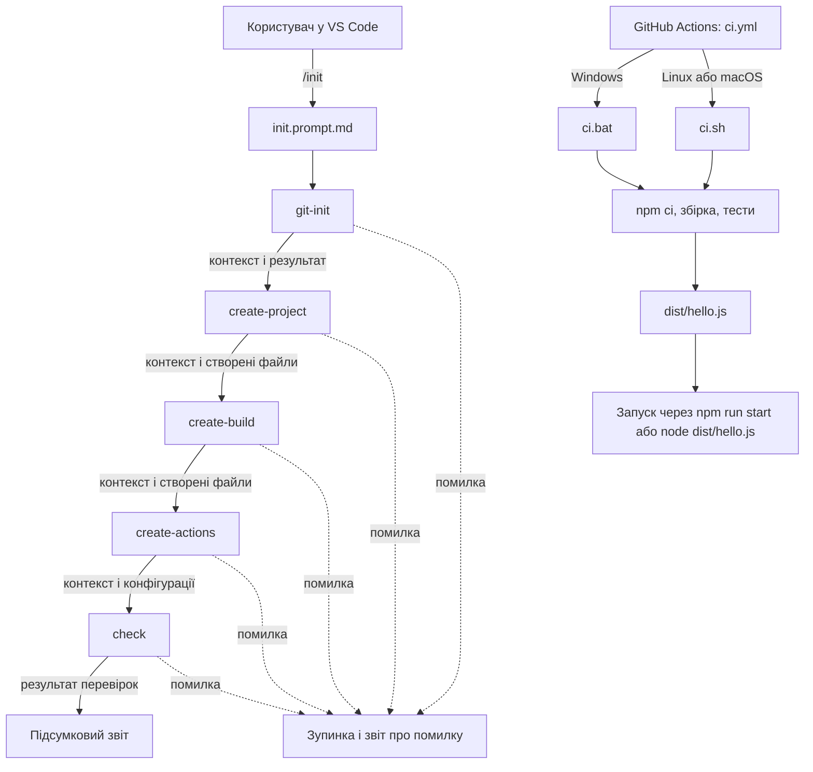

# Архітектура AI-агента

## Проблеми, які вирішує агент

Агент автоматизує повторюване початкове налаштування TypeScript-проєкту: створення структури файлів, конфігурації npm і Vitest, скриптів складання та тестування, а також CI workflow. Послідовні спеціалізовані команди роблять процес відтворюваним, а рання перевірка допомагає визначити етап, на якому сталася помилка.

## Відповідність файлів і ролей

| Файл | Роль |
|---|---|
| `.github/agents/build-engineer.agent.md` | Manifest агента: описує його призначення та робочі правила. |
| `.github/skills/project-scaffold/SKILL.md` | Skill для створення структури та файлів TypeScript-проєкту. |
| `.github/skills/build-and-test/SKILL.md` | Skill для налаштування складання, тестів і локальних CI-скриптів. |
| `.github/skills/github-actions/SKILL.md` | Skill для налаштування GitHub Actions. |
| `.github/prompts/git-init.prompt.md` | Команда ініціалізації Git. |
| `.github/prompts/create-project.prompt.md` | Команда створення проєкту. |
| `.github/prompts/create-build.prompt.md` | Команда створення конфігурації складання, тестів і CI-скриптів. |
| `.github/prompts/create-actions.prompt.md` | Команда створення GitHub Actions workflow. |
| `.github/prompts/check.prompt.md` | Команда перевірки результату. |
| `.github/prompts/init.prompt.md` | Orchestrator, який викликає етапи ініціалізації по черзі. |
| `.github/workflows/ci.yml` | CI workflow для Windows, Linux і macOS. |
| `package.json` | npm-залежності та scripts для складання й тестування. |
| `tsconfig.json` | Конфігурація компілятора TypeScript. |
| `vitest.config.ts` | Конфігурація Vitest. |

Для TypeScript замість `CMakeLists.txt`, наведеного в методичці, використовуються `package.json`, `tsconfig.json` і `vitest.config.ts`.

## Каталог складання та Git

Для TypeScript аналогом каталогу `build/` з методички є `dist/`: у ньому розміщується зібраний застосунок `dist/hello.js`. Каталоги `dist/` і `node_modules/` мають бути зазначені у `.gitignore` і не потрапляти під Git: це відповідно результат складання та встановлені залежності, які можна відтворити локально.

## Skills агента

| Skill | Призначення | Вхід | Вихід | Перевірки |
|---|---|---|---|---|
| `project-scaffold` | Створити початкову структуру TypeScript-проєкту з точкою входу та тестом `BasicAddition`. | Назва проєкту, мова TypeScript, вимоги до Hello World і тесту. | Структура проєкту, вихідний файл і файл тесту. | Очікувані файли створені; вихідний код і тест відповідають вимогам та використовують коректні шляхи. |
| `build-and-test` | Налаштувати npm scripts, TypeScript/Vitest і кросплатформні локальні скрипти складання та тестування. | Структура проєкту, залежності й вимоги до команд складання та тестування. | `package.json`, `tsconfig.json`, `vitest.config.ts`, `ci.sh` і `ci.bat`. | `npm ci` завершується успішно; складання створює `dist/hello.js`; тести Vitest проходять; файл запускається через `npm run start` або `node dist/hello.js`. |
| `github-actions` | Налаштувати CI для перевірки проєкту на Windows, Linux і macOS. | Цільові ОС та шляхи до `ci.sh` і `ci.bat`. | `.github/workflows/ci.yml`, який викликає відповідний платформний скрипт. | Workflow має матрицю трьох ОС і делегує збірку та тести скриптам, а не дублює їхні команди. |

## Команди для користувача

| Команда | Що робить | Коли запускати |
|---|---|---|
| `git-init` | Перевіряє або ініціалізує Git-репозиторій без руйнівних операцій. | На початку налаштування, якщо репозиторій ще не ініціалізовано. |
| `create-project` | Створює структуру Hello World на TypeScript і тест `BasicAddition`. | Після підготовки Git, щоб створити основу проєкту. |
| `create-build` | Налаштовує npm scripts, конфігурації TypeScript/Vitest і скрипти `ci.sh` та `ci.bat`. | Після створення вихідного коду, щоб скласти й протестувати проєкт. |
| `create-actions` | Створює GitHub Actions workflow для Windows, Linux і macOS, який запускає платформний CI-скрипт. | Після налаштування локальної збірки та тестів. |
| `check` | Перевіряє створені файли, конфігурацію, складання, тести та результат запуску. | Після створення проєкту або окремого етапу, щоб підтвердити його результат. |
| `init` | Оркеструє `git-init` → `create-project` → `create-build` → `create-actions` → `check` і зупиняється з описом помилки, якщо етап не пройшов. | Для повного налаштування проєкту однією командою `/init`. |

## Потік даних

Між етапами передаються назва проєкту, мова програмування та потрібні параметри конфігурації, перелік створених або оновлених файлів і результат перевірок. Кожен наступний етап використовує цей контекст, щоб продовжити роботу над тим самим проєктом і повідомити orchestrator про успіх або помилку.

## Послідовність `/init`

Orchestrator запускає етапи в такому порядку:

1. `git-init`
2. `create-project`
3. `create-build`
4. `create-actions`
5. `check`

Якщо будь-який етап завершується помилкою, orchestrator зупиняється і формує звіт із назвою етапу та описом того, що саме не вдалося. Наступні етапи після помилки не запускаються.

## CI та складання

Workflow `ci.yml` лише вибирає потрібний платформний скрипт: `ci.sh` для Linux/macOS або `ci.bat` для Windows. Самі скрипти виконують `npm ci`, збірку проєкту й тести Vitest, а також створюють виконуваний файл застосунку `dist/hello.js`. Його запуск: `npm run start` або `node dist/hello.js`.

## Ідемпотентність і межі повноважень

Повторний запуск команд має бути ідемпотентним: він не руйнує наявні файли та не створює їхні дублікати.

Агенту заборонено:

- видаляти файли;
- виконувати `git push --force` або переписувати історію Git;
- працювати із секретами чи запитувати їх;
- змінювати налаштування захисту гілок.

## Діаграма взаємодії

